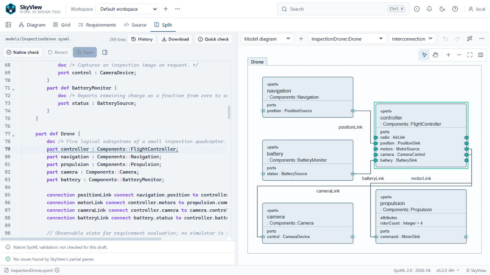

<div align="center">


<h1>SkyView</h1>

<p><strong>An open-source graphical design tool for SysML v2</strong></p>
<p>Create, visualize, edit and validate system models in your browser.</p>

[](https://github.com/Rexus/SkyView/actions/workflows/check.yml)
[](LICENSE)
[](go.mod)
[](web/package.json)

**[Quick start](#quick-start) · [Examples](examples/) · [Documentation](#documentation) · [Contribute](#contributing) · [Report a bug](https://github.com/Rexus/SkyView/issues)**

</div>

SkyView is a browser-based workbench with a Go backend and a React interface.
Explore and edit systems through diagrams, tables, requirements and source code, with models
stored as plain `.sysml` files.

[](docs/images/skyview-drone.jpg)

_Captured 28 November 2026 · SkyView v0.2.0 development build · base revision `9ac970f45c76`
with v0.3 workbench changes._

> **Experimental:** SkyView implements a subset of SysML v2. OMG conformance has not been established.
> See [language support](#language-support) and the [initial baseline record](docs/baseline.md) for known limits.

Explore the [inspection drone example](examples/inspection-drone/): connected subsystems, four requirements,
mission behavior and planned verification checks. The native-valid model loads without diagnostics.
The guide includes a generated sequence preview and the current behavior-view limitations.

Try the [inverted pendulum example](examples/inverted-pendulum/) for a cart-on-a-rail control problem:
physical parts, a Simulink-style signal loop, swing-up and automatic balance, requirements,
and an optional runnable scientific simulation.

**Contents:** [Features](#features) · [Quick start](#quick-start) · [Development](#development) ·
[Documentation](#documentation) · [Language support](#language-support) ·
[Project layout](#project-layout) · [Contributing](#contributing) · [Origins](#origins)

## Features

- **Visual modeling:** interconnection and containment diagrams, automatic layout, port connections,
  saved node positions and diagram notes.
- **Grid editing:** edit element names, types, values and documentation; add or remove elements.
- Review **requirements** in a configurable table, filter for model gaps, and edit Markdown
  documentation. Export the current table as CSV. [Requirements guide](docs/viewer-design.md#review-requirements)
- **Native validation:** project-wide checks against the pinned official SysML pilot, including unsaved drafts,
  with source hashes and per-file diagnostics. [Set up the native checker](docs/standards.md#run-locally).
- **Source editing:** syntax highlighting, [inline diagnostics and suggested fixes](docs/local-development.md#source-validation), and direct access to the model text.
- **File workflows:** import and download `.sysml` files, undo and redo visual model edits,
  and restore saved model snapshots.
- **Custom diagram views:** import/export native model bundles and render selected views consistently in the
  browser or CLI. Add nested boundary annotations, local layout patterns and locked groups through
  [shared presentation controls](docs/shared-presentation.md). See [model exchange](docs/model-exchange.md).
- **Workspaces and projects:** choose a workspace in the header and a project in the left panel.
  Projects support nested models and views, bundled examples, ZIP upload/export,
  public GitHub/GitLab snapshots and configured local folders. See the [project guide](docs/projects.md).
- **Workspace UI:** diagram-first navigation with Projects, Model elements and Settings on the left,
  floating or docked properties on the right, portable role palettes, a command palette, and light and dark themes.

Structured edits modify the source text and reparse the model. Diagram positions and notes are stored
separately. Reliable preservation of arbitrary SysML models across edits remains to be verified.

## Quick start

Install Go 1.24 or later. From the repository root, run:

```sh
go run ./cmd/skyview -addr 127.0.0.1:8081
```

Open [SkyView](http://127.0.0.1:8081), choose **Projects → Examples**, and use the inspection drone,
inverted pendulum or starter system. Each opens as an independent editable project.
The repository includes a built web interface, so this first run does not require Node.js or Nix.
Port 8081 lets SkyView run alongside SysON on 8080. See the [Go setup guide](deployment/go/) for
Windows, AlmaLinux WSL and standalone executables. For a container, follow the
[Docker or Podman guide](deployment/docker/). Both run a single-user workspace on localhost.

For hosted multi-user access, use the [hosted Kubernetes deployment](deployment/caas/).
Browse [all deployment options](deployment/) or [all example projects](examples/).

## Development

To rebuild the interface, use Node.js 22 and npm in addition to Go. From the repository root:

```sh
npm --prefix web ci
npm --prefix web run build
```

The frontend build writes to `internal/server/dist/`, which Go embeds in the application.
Restart the Go server after rebuilding to serve the updated interface.

For live frontend development, start the Go server with `-addr 127.0.0.1:8080` and start a second terminal
at the repository root:

```sh
npm --prefix web run dev -- --host 127.0.0.1
```

Open [the development interface](http://127.0.0.1:5173). Its API requests are forwarded to the Go server.

Run the existing Go checks from the repository root:

```sh
go test . ./cmd/... ./internal/... ./examples/...
go vet . ./cmd/... ./internal/... ./examples/...
```

Run the [native repository gate](docs/standards.md#repository-gate) with JDK 21+ in addition to Go:

```sh
go run ./cmd/skyview standards-setup
go run ./cmd/skyview lint -repository -timeout 5m -report bin/sysml-validation/latest.json
```

The tests cover the bundled models, scoped reference resolution, behavior and constraint parsing,
source edits, quoted identifiers and model exchange. They are not a SysML conformance suite.

To build a standalone executable after building the interface, use
`go build -o bin/skyview.exe ./cmd/skyview` on Windows or
`go build -o bin/skyview ./cmd/skyview` on Linux and macOS.

The footer shows the current app version and SysML release. Select the app version to see deployment
and build details or copy a build report. See [contributing and releases](CONTRIBUTING.md) for the version and release workflow.

A Nix development environment is also provided in [flake.nix](flake.nix). On a host with Nix flakes
enabled, run `nix develop`, install the frontend dependencies with `npm --prefix web ci`,
then use `make build`, `make dev-api`, `make dev-web`, `make test` or `make vet`.

Build a complete local bundle with `bash deployment/go/build.sh` (Go, Node.js and JDK 21+), then run
`bin/local/skyview`. `SYSML_CHANNEL=latest` permits preview standards; `SYSML_CHANNEL=locked` reproduces
the recorded version. Downloaded upstream artifacts remain in ignored build/cache directories.
See [build channels](docs/standards.md#build-channels).

## Documentation

| I want to… | Start here |
| --- | --- |
| Run SkyView locally or host it | [Deployment options](deployment/README.md) |
| Explore a complete example | [Inspection drone](docs/drone-example.md) · [Inverted pendulum](docs/pendulum-example.md) |
| Import a project or move my models | [Projects and workspaces](docs/projects.md) · [Model exchange](docs/model-exchange.md) |
| Arrange and share a diagram | [Custom diagram views](docs/shared-presentation.md) |
| Understand the checker and language limits | [Standards and validation](docs/standards.md) |
| Work on the code | [Contributing](CONTRIBUTING.md) · [Architecture](architecture/README.md) · [HTTP API](docs/api.md) |

[Tom Sawyer SysML v2 Viewer](docs/viewer-design.md) is the agreed reference for SkyView's design,
behavior and appearance. SkyView uses its own code and assets.

## Language support

[OMG specifications and the pinned official release](docs/standards.md) govern language meaning and
native validation. Builds use published standards by default; an explicit `latest` option permits
previews. The footer identifies the running release and local checker integrity.

The custom Go parser supports selected declarations, types, values, documentation, connections,
dependencies and satisfaction links. It also projects the drone example's use case, constraints,
ordered actions, event occurrences, typed messages, state ordering and verification references.
Diagnostics include unresolved references, malformed supported expressions and duplicate names.

Known boundaries include:

- In the rendering parser, imports resolve within the parsed source, including combined model bundles. External files and
  standard libraries are not loaded automatically for rendering. Native checking loads the pinned official
  libraries and all project sources separately. The renderer recognizes a finite subset of library names:
  scalar types and selected SI mechanical quantities. The exact catalogue is in
  [quantities.go](internal/sysml/quantities.go); unit conversion and dimensional analysis are not implemented.
- Some constructs, including native `view`, `rendering`, `concern`, `alias` and `metadata`, remain
  unprojected; their source is preserved and the projection gaps are reported.
- Sequence, activity and state diagrams, constraint evaluation and verification execution are not
  implemented. The grid and inspector expose the supported behavior relationships and expressions.
- Successful parsing or display does not establish full language validity or semantic correctness.
- Satisfaction links express model relationships; their presence does not establish that a
  requirement has passed verification.

Conformance work should be assessed against the OMG SysML 2.0 and KerML 1.0 specifications [1][2].
The [HTTP API](docs/api.md) is specific to SkyView; conformance to the separate OMG Systems Modeling
API and Services specification has not been established [3].

## Project layout

| Path | Responsibility |
| --- | --- |
| `cmd/skyview/` | Application entry point |
| `internal/sysml/` | Partial rendering parser, model representation, diagnostics and source edits |
| `internal/standards/` | Pinned official validator, library integrity, native project checks |
| `internal/server/` | HTTP API, workspace storage, history and embedded interface |
| `web/` | React, TypeScript and Vite frontend |
| `internal/projects/` | Project directories, archive safety and Git snapshot import |
| `examples/` | Versioned, embedded example project templates |
| `workspace/` | Ignored runtime projects and legacy files |
| `architecture/` | Native project design contract and implementation map |
| `deployment/` | Go, Docker/Podman and Kubernetes files and guides |
| `scripts/` | Shared native model validation and export tooling |

## Contributing

Bug reports, small example models, documentation improvements and code contributions are welcome.
If a model does not behave as expected, a minimal `.sysml` example and the app's **Copy build report**
help us reproduce it. See [how to report a bug](CONTRIBUTING.md#report-a-bug) before sharing project data.

[Open an issue](https://github.com/Rexus/SkyView/issues/new/choose) to report a problem or suggest an improvement,
or follow the [contributor guide](CONTRIBUTING.md) to open a pull request against `main`.
See the [security policy](SECURITY.md) for private vulnerability reporting.

## Origins

SkyView began as an experiment created by Carl Maier with assistance from a locally hosted language model,
inspired by a demonstration of SysON. Its continued development aims to combine approachable visual
modeling with dependable SysML v2 support.

We use AI assistance in ongoing development and documentation. Project maintainers review changes
and run the project checks before releases.

## License

[MIT](LICENSE), copyright (c) 2026 Carl Maier and Viktor Ingre.
Bundled dependencies retain their own licenses; see [third-party notices](THIRD_PARTY_NOTICES.md).

## References

1. OMG, [SysML 2.0](https://www.omg.org/spec/SysML/2.0).
2. OMG, [KerML 1.0](https://www.omg.org/spec/KerML/1.0).
3. OMG, [Systems Modeling API and Services 1.0](https://www.omg.org/spec/SystemsModelingAPI/1.0).
