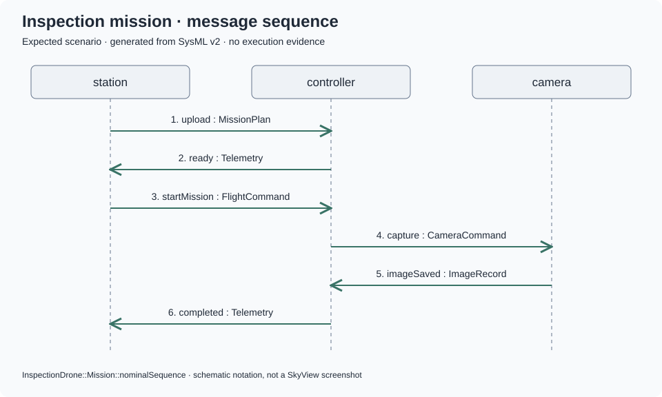

# Explore the inspection drone

[Back to SkyView](../README.md) · [Native model](../examples/inspection-drone/models/InspectionDrone.sysml)

This fictional inspection quadcopter is a small, connected example for exploring SkyView and finding
gaps in its SysML v2 support. A pilot uploads a waypoint mission, the vehicle captures an image, and
then returns. PX4's mission, return and failsafe documentation provides the domain context [1–3].
The 20% battery threshold and 3-second link timeout are **invented demonstration choices**, not PX4
defaults, regulatory limits or a complete aircraft design.

## Open it

Start SkyView using the [local run guide](local-development.md), choose **Projects → Examples**,
and click **Use example** for **Inspection drone**. The model opens as an independent editable copy;
the bundled template remains available. This works identically in Go, Docker and Podman builds.
See [projects](projects.md) to upload a directory, import a repository or export your changes.

1. Open **Diagram**, select scope **InspectionDrone::Drone**, and use **Interconnection**.
   Five subsystem nodes and four links show navigation, battery, controller, camera and propulsion.
2. Switch to **Containment** to explore ownership. Select **InspectionDrone::InspectionSystem** for
   the ground station, drone and external pilot role. The current diagram does not distinguish
   reference ownership graphically; `ref part pilot` is an external role in the source.
3. Open **Requirements**. The four obligations have satisfaction links to the drone. Use **Columns**
   to show **Satisfaction assertions** beside the required constraints. Select a planned verification
   link to inspect the test intent. This example records verification plans.
4. Use **Grid** or the outline to inspect `Mission` and `Verification`. Select a message for its payload
   and resolved event endpoints, a constraint for its expression, or a verification reference for its
   target. Use **Source** for behavior edits that have no structured editor.

## What is modeled

| Model area | Useful coverage |
| --- | --- |
| `Components` | Item payloads, complementary input/output ports, part definitions and documentation |
| `Drone` | Five subsystem usages, four connections, a rotor-count value and observable state attributes |
| `InspectionSystem` | Ground-to-air connection, nested endpoint resolution and an external pilot reference |
| `Requirements` | Four obligations with Boolean/quantity constraints: preflight, battery reserve, link loss and image evidence |
| `Mission::inspectSite` | Human-led use case with a subject, actor and objective |
| `Mission::nominalMission` / `lostGroundLink` | Success-path and alternative activity sketches |
| `Mission::nominalSequence` | Six ordered messages, typed payloads and event endpoints on three participants bound to the design |
| `Mission::FlightLifecycle` | Nominal state sketch; detailed triggers, guards and failure transitions are intentionally absent |
| `Verification` | Four planned checks, each with a subject, native `verify` link and observable acceptance criteria |

The model owns the requirements and procedures. It supplies no autopilot implementation, simulator,
flight dynamics, detailed electrical design or executed verification verdicts. Connections express
logical connectivity; the camera and radio exchanges contain traffic in both directions even where
SkyView draws a single connection arrow.

## Mission sequence preview

[](images/drone-sequence.svg)

This schematic preview is generated from the official parser's resolved model, including native
message endpoints, payload types and succession order. It is **not a SkyView sequence-diagram view**
or a claim of standard graphical notation. All arrows denote message occurrences; they do not assert
synchronous calls or execution timing. Edit the `.sysml` source and regenerate the preview.

## Current support and checks

Checked on 2026-11-27 after the parser fix. The model is unchanged (SHA-256 prefix `6ca56097`):

- The complete project passes the published **2026-04** baseline, kernel **0.59.0**, using Java 21.
  It has no project errors; two inherited official-library findings remain visible separately.
  See the [current validation record](sysml-validation.json) and [checking policy](standards.md).
  Native review covered
  definition/usage ownership, directed port payloads, participant bindings, message ordering,
  requirement subjects, quantity typing and verification targets.
- An isolated negative copy with a nonexistent camera type is rejected by the native validator,
  including the resulting unresolved connection endpoint.
- SkyView loads the complete file with **zero diagnostics and zero unprojected constructs**, replacing
  the initial 67 false warnings. Regression tests check all five connections, four satisfaction links,
  four native constraints, six messages, twelve events, thirty-one successions and four verification
  references. Participant bindings and message payloads/endpoints resolve to their modeled identities.
- Negative tests keep missing types, members, event endpoints, ordering targets, units and verification
  targets visible. Syntax errors in supported expressions are reported rather than discarded.
- Identity-aware renames update constraints, participant bindings, message endpoints, succession and
  verification references without renaming unrelated elements with the same name. Regression tests
  cover these edits; arbitrary SysML edit safety remains outside the supported subset.
- The running Go app was checked in Codex's built-in browser: clean model, five subsystem nodes,
  four structural links, native constraints, planned verification navigation and resolved message
  endpoints. The README screenshot records that view.
- HTTP load/download preserved the source byte for byte. On a disposable copy, six renames and
  message/constraint documentation edits retained zero diagnostics; unsafe message type editing was
  rejected, and download/reimport was byte-exact. The complete edited copy also passed the same native
  validator (edited SHA-256 prefix `53307c57`), including all imports.
- Sequence, activity and state-diagram views, constraint evaluation and verification execution are
  **not implemented**. The grid and inspector expose supported expressions and relationships; use
  the generated sequence preview for the interaction picture. Parsing is not execution or full OMG
  conformance. Library recognition is a finite subset; see the current [language boundaries](../README.md#language-support).

Try the following on a disposable copy. These are manual regression ideas, not claims that every
editing path has passed:

| Exercise | Check |
| --- | --- |
| Change `rotorCount` in the grid | Source changes at the intended attribute; undo/redo restores the value |
| Move diagram nodes, then reload | Layout persists without changing the SysML source |
| Edit requirement documentation | Text updates in cards and source; the satisfaction link remains intact |
| Save source, download, then re-import | Compare the full text, especially behavior and constraint bodies |
| Break a connection endpoint on the copy | A diagnostic appears; restore the source and revalidate |
| Change a message endpoint or ordering | Native validation and regenerated preview reflect the change |

Revalidate the complete model with **Native check** or the [CLI gate](standards.md) after edits.
SkyView's **Quick check** remains a bounded rendering projection. Unsupported
structured field operations are disabled; the full native source remains available for editing.

## Regenerate the sequence preview

Use JDK 21+, Python 3.10+ and the [pinned toolchain setup](standards.md#run-locally).
Run `go run ./cmd/skyview standards-setup` first. Set `SYSML_JAVA` to the Java executable,
`SYSML_KERNEL` to the installed `kernel.jar`, and `SYSML_LIBRARY` to the installed `sysml.library`.
The default toolchain directory is `~/.cache/skyview/sysml/2026-04` on Linux/WSL or
`%LOCALAPPDATA%/skyview/sysml/2026-04` on Windows; `SKYVIEW_SYSML_HOME` can override it.
These preview tools are optional; the same pinned checker is used by **Native check** and CI.

From the repository root in PowerShell:

```powershell
& $env:SYSML_JAVA -cp $env:SYSML_KERNEL scripts/ExportSysML.java $env:SYSML_LIBRARY examples/inspection-drone/models/InspectionDrone.sysml InspectionDrone bin/drone-native.json
if ($LASTEXITCODE -ne 0) { throw 'Native SysML validation failed' }
python examples/inspection-drone/tools/render-sequence.py bin/drone-native.json docs/images/drone-sequence.svg
```

`ExportSysML.java` delegates parsing, library resolution and export to the official implementation.
The renderer reads that export rather than parsing SysML text. It supports this compact linear
three-participant scenario and rejects branching, cycles, missing order and self messages instead
of guessing a picture. The SVG uses explicit colors and system fonts and needs no modeling server.
The generated preview was checked locally; GitHub rendering has not yet been checked after publication.

## README screenshot

To refresh the README screenshot, open the bundled Inspection Drone example in light mode. Choose
**Split**, set the diagram scope to **InspectionDrone::Drone**, and choose **Interconnection**.
Use **Fit diagram to window** to show all five nodes and select the controller to reveal its
declaration in Source. Hide the sidebar and use **Element properties** in the Source toolbar to
hide the panel if it obscures the diagram. Capture the application viewport to `docs/images/skyview-drone.jpg`,
including the footer and its diagnostics. Update the README caption with the capture date, app
version and revision from **Copy build report**. Identify the recorded revision as the base
revision if the build contains uncommitted changes.

## References

1. PX4, [Mission mode](https://docs.px4.io/main/en/flight_modes_mc/mission): waypoint mission context.
2. PX4, [Return mode](https://docs.px4.io/main/en/flight_modes_mc/return): recovery behavior context.
3. PX4, [Safety configuration](https://docs.px4.io/main/en/config/safety): battery and ground-link failsafe concepts.
4. OMG, [SysML 2.0 language](https://www.omg.org/spec/SysML/2.0/Language/PDF): language authority.
5. Systems Modeling, [SysML v2 pilot release 2026-04](https://github.com/Systems-Modeling/SysML-v2-Pilot-Implementation/releases/tag/2026-04): validator and bundled libraries.
6. Systems Modeling, [official training examples](https://github.com/Systems-Modeling/SysML-v2-Release/tree/master/sysml/src/training): ports, occurrences, requirements, use cases and verification syntax. The drone model is original example content; external examples are not vendored.
