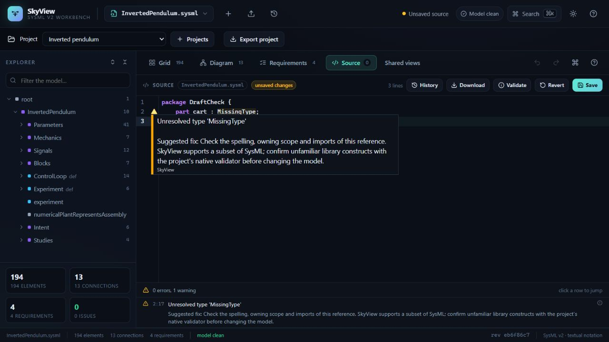

# Run SkyView locally

[Back to the README](../README.md)

Use either the native Go app or a Linux container. Both serve the same interface and store models
in a workspace directory. The examples use port **8081**, so SkyView can run alongside SysON on 8080.

## Contents

- [Go app](#go-app)
- [Windows with AlmaLinux WSL](#windows-with-almalinux-wsl)
- [Docker](#docker)
- [Podman](#podman)
- [Source validation](#source-validation)
- [Data and recovery](#data-and-recovery)

## Go app

Install [Go](https://go.dev/dl/) 1.24 or later. Reopen your terminal after installation so `go` is
on its PATH. The checked-in interface lets you start without Node.js or Nix.

From the repository root:

```sh
go run ./cmd/skyview -addr 127.0.0.1:8081
```

Open [SkyView](http://127.0.0.1:8081). Use **Projects → Examples** to start an editable example, then
open Grid, Diagram, Requirements or Source. Stop the server with Ctrl+C.
See [projects](projects.md) for ZIP uploads, repository snapshots and local folders.

`-workspace ./my-workspace` chooses the persistent workspace root (default `./workspace`).
To expose an existing model directory or checkout, add `-project NAME=PATH`; see the
[local project guide](projects.md#local-folders). Paths are relative to where you start the app.

To build and run an executable on Windows, from the repository root:

```powershell
go build -o bin/skyview.exe ./cmd/skyview
./bin/skyview.exe -addr 127.0.0.1:8081
```

On Linux or macOS:

```sh
go build -o bin/skyview ./cmd/skyview
./bin/skyview -addr 127.0.0.1:8081
```

Keep `LICENSE` and `THIRD_PARTY_NOTICES.md` with copies of the executable.
See [Development](../README.md#development) before changing or rebuilding the interface.

## Windows with AlmaLinux WSL

This route runs the Linux Go toolchain while keeping Windows Smart App Control enabled.
It uses the same repository and workspace on your Windows drive; no second checkout or container
is required. A Linux executable built here runs inside WSL.

With an existing `AlmaLinux-10` WSL distribution, install Go once from a PowerShell terminal:

```powershell
wsl -d AlmaLinux-10 --user root --exec dnf install --assumeyes golang
```

Then, from the repository root in PowerShell, start SkyView:

```powershell
wsl -d AlmaLinux-10 --exec go run ./cmd/skyview -addr 127.0.0.1:8081
```

Keep that terminal open and visit [SkyView](http://127.0.0.1:8081) in your Windows browser.
Press Ctrl+C in the terminal to stop it. WSL inherits the current repository directory, so the
default `./workspace` is the same folder used by the Windows checkout. Stop any other SkyView
instance using port 8081 before starting this one.

To run the checks from the same PowerShell directory:

```powershell
wsl -d AlmaLinux-10 --exec go test -timeout 90s ./cmd/... ./internal/... ./examples/...
wsl -d AlmaLinux-10 --exec go vet ./cmd/... ./internal/... ./examples/...
```

If you use a different distribution name, find it with `wsl --list --quiet` and replace
`AlmaLinux-10` in the commands. The installation command above applies to AlmaLinux.
Windows-native `.exe` files remain subject to Windows Application Control; Git commit signing
does not sign those executables.

## Docker

Install Docker Engine or Docker Desktop with Linux containers enabled and start its engine.
From the repository root, build and start:

```sh
docker build -t skyview:local .
docker run -d --name skyview -p 127.0.0.1:8081:8080 -v skyview-workspace:/data skyview:local
```

Open [SkyView](http://127.0.0.1:8081). The image builds the interface and Go executable itself;
Go and Node.js are not required on the host.

The named volume `skyview-workspace` is created automatically. It retains your models, layouts and
history when the container is removed. The image runs as UID/GID 65532 and includes a writable
`/data` directory for the initial volume.

Inspect logs, stop, and start the same container:

```sh
docker logs skyview
docker stop skyview
docker start skyview
```

After rebuilding the image, recreate the stopped container with the same volume:

```sh
docker stop skyview
docker rm skyview
docker run -d --name skyview -p 127.0.0.1:8081:8080 -v skyview-workspace:/data skyview:local
```

## Podman

Install Podman. On Windows or macOS, initialize a Podman machine once with `podman machine init`,
then start it with `podman machine start`. A native Linux installation does not need that VM.

From the repository root:

```sh
podman build -t localhost/skyview:local .
podman run -d --name skyview -p 127.0.0.1:8081:8080 -v skyview-workspace:/data:U localhost/skyview:local
```

Open [SkyView](http://127.0.0.1:8081). The `:U` option sets ownership of this named volume for the
container user. Docker and Podman have separate image and volume stores.

Use `podman logs skyview`, `podman stop skyview` and `podman start skyview` to manage the container.
To update it, rebuild, stop and remove the container, then repeat the run command with the same volume.

## Source validation

Open a model's **Source** tab. SkyView checks the current draft after a short typing pause;
**Validate** checks it immediately. Validation does not save the file.

- Errors and warnings underline the affected text and mark the corresponding line in the gutter.
- Hover over the marked text or gutter marker for the reason and a suggested fix when available.
- Click a diagnostic row to select its exact source range. **F8** moves to the next diagnostic;
  **Ctrl+Shift+M** (macOS: **Cmd+Shift+M**) opens CodeMirror's diagnostic panel.
- Editing clears outdated highlights immediately. Results from earlier drafts or another file/project
  cannot replace current results. A connection failure is shown as **Validation unavailable**.

Suggestions are review guidance; SkyView does not apply them automatically. Its parser supports a
subset of SysML v2, so an unresolved library reference can be a tool limitation. Keep the project's
native SysML validation as the conformance gate. Opening a CRLF file does not mark it as edited;
source editing uses LF line endings when saved.



The HTTP diagnostic format is described in [the API reference](api.md#source-diagnostics).
Frontend regression tests cover ranges, hover content, draft changes and validation failures.
Run them from `web/` with `npm test`; GitHub and GitLab CI use the same command.

## Data and recovery

The native app's `./workspace` and the container's named volume are separate workspaces.
Use **Export project** and **Projects → Upload ZIP** to move models, views, layouts and assets between
them. Copy the entire workspace when you also need revision history. Back up any separately configured
local project folders too; they are not copied into the workspace.

For a container backup, stop SkyView and copy its workspace to a new local directory:

```sh
docker stop skyview
docker cp skyview:/data ./skyview-backup
docker start skyview
```

Use the equivalent `podman` commands for a Podman container. To inspect a backup with the native app,
run `go run ./cmd/skyview -addr 127.0.0.1:8081 -workspace ./skyview-backup` after stopping any other
SkyView process on port 8081.

The History dialog can restore saved model snapshots. Deleting a model in the UI also deletes its
history and layout, so retain independent backups. Removing the named volume deletes all its data.

If startup fails, check the logs and whether port 8081 is already in use. For a native workspace,
check that your account can write to the selected directory. For containers, use a fresh named volume
or ensure an existing one is writable by the container user.

These examples expose the app only on localhost. SkyView has no built-in authentication.
