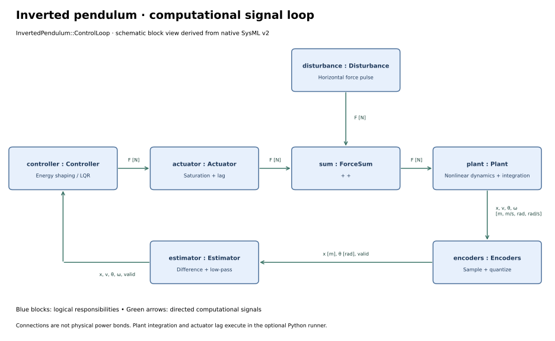
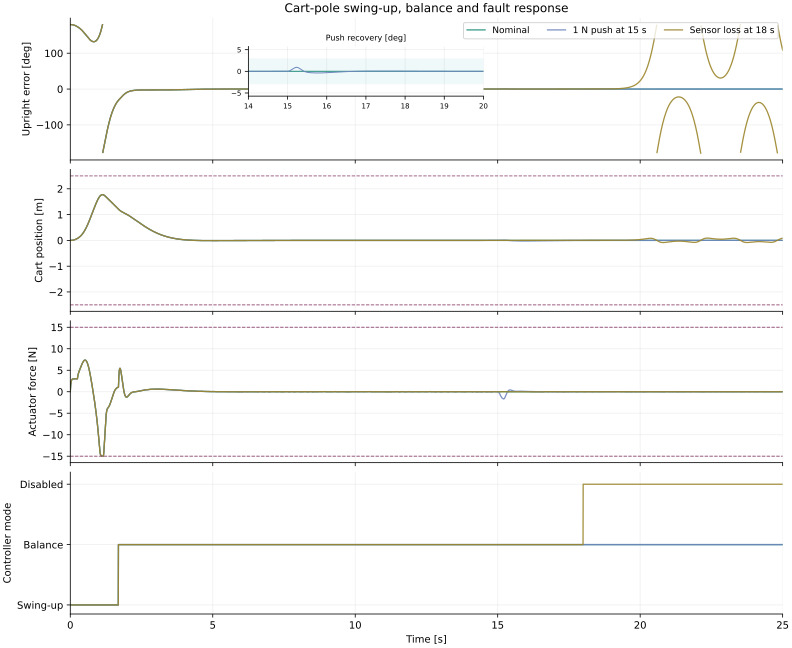

# Inverted pendulum example

A cart moves along a horizontal rail to swing a hinged rod from downward rest into upright balance.
Open [InvertedPendulum.sysml](../examples/inverted-pendulum/models/InvertedPendulum.sysml) in SkyView to explore the mechanics,
control loop, requirements, operating sequence and planned verification cases.

[](images/pendulum-control.svg)

This schematic uses the native model's seven blocks, typed port payloads and seven connections.
Arrows show computational signal direction, verified from the output/input payloads. They are not
mechanical power bonds. This is a generated preview, not a SkyView screenshot or standard graphical notation.

**Contents:** [Explore](#explore-in-skyview) · [Run](#run-the-simulation) ·
[Control](#control-and-physical-assumptions) · [Checks](#checks-and-results) ·
[Change the model](#change-parameters-or-topology) · [References](#references)

## Explore in SkyView

Start SkyView using the [local run guide](local-development.md), then choose **Projects → Examples →
Inverted pendulum → Use example**. This creates an independent editable project without an upload.
For a container with its own workspace volume, import the file through the app's file-import control.
Python and the native validator are optional and are not needed to browse the example.

| Scope | What to inspect |
| --- | --- |
| `Mechanics::Assembly` | Rail, cart, uniform rod, pivot, force drive and two encoders; six physical connections |
| `ControlLoop` | Controller, force-limited actuator, force summation, nonlinear plant, encoders, estimator and disturbance |
| `Parameters` | 41 native scalar/quantity inputs, including SI units, initial conditions, controller settings and criteria |
| `Signals` | Position, velocity, angle, angular velocity, force and measurement-validity contracts |
| `Intent` | Swing-up use case, ordered operating activity and four requirements |
| `Studies` | Analysis owner and three verification cases with five native `verify` links |

Select **Diagram → InvertedPendulum::ControlLoop → Interconnection** for the feedback loop.
Use the grid and inspector for quantities, requirements and verification intent. The same diagram mode
can show `Mechanics::Assembly`; its generic physical connections do not imply directed signal flow.
SkyView does not execute the simulation, evaluate constraints or render a Simulink canvas.
The separate runner below executes this specific model binding.

## Run the simulation

Use Python **3.12 or later**. On Windows, the commands below run in the existing AlmaLinux WSL terminal,
from the SkyView repository root. They also work in a Linux shell:

```sh
python3 -m venv ~/.cache/skyview/pendulum-venv
~/.cache/skyview/pendulum-venv/bin/python -m pip install -r examples/inverted-pendulum/simulation/requirements.txt
~/.cache/skyview/pendulum-venv/bin/python examples/inverted-pendulum/simulation/run.py
```

On a machine where a suitable Python environment is already active, the last two commands become
`python -m pip install -r examples/inverted-pendulum/simulation/requirements.txt` and `python examples/inverted-pendulum/simulation/run.py`.
No MATLAB or Simulink installation is required. NumPy, SciPy and Matplotlib are optional scientific
analysis dependencies, separate from SkyView's Go runtime; see [third-party notices](../THIRD_PARTY_NOTICES.md#optional-pendulum-analysis-tools).

The runner writes `bin/pendulum-results/` (ignored by Git):

- `report.json`: verdicts, observed requirement values, parameters, model/implementation fingerprints,
  library versions, LQR gain and numerical checks.
- `nominal.csv`, `disturbance.csv`, `sensorLoss.csv`: time histories with SI units in the header.
- `response.svg` / `.png`: actual simulation response, including the expected loss of balance after shutdown.
- `control-loop.svg` / `.png`: selected native signal topology.

A failed requirement, invalid binding, stale input or numerical check returns a nonzero exit status.
The newest attempt replaces the report status immediately, so an interrupted run cannot masquerade
as an older pass. Older plot files can remain after a failure; always inspect the current report first.
Use `--output another-directory` to retain a separate experiment's complete results.

## Control and physical assumptions

The example follows the cart-pole energy-shaping and local-balance approach described in MIT's
Underactuated Robotics notes [1]. The implementation is original and extends the ideal point-mass
case to a uniform rigid rod, with pivot inertia derived from mass and center-of-mass distance.
The exact equations and the upright linearization have one implementation in
[dynamics.py](../examples/inverted-pendulum/simulation/dynamics.py); the native model owns their parameters and binding.

A short force kick breaks the exact downward equilibrium. Energy shaping with cart-centering feedback
raises the rod; an angle/speed gate hands over to continuous-design LQR, executed at the sampling rate.
A wider release gate provides hysteresis. The actuator limits the requested force and adds a first-order
lag. Two quantized position measurements feed filtered finite-difference velocity estimates.
Invalid sensing latches the controller off until a new run; actual force decays rather than stopping instantly.

The current model uses a 1 kg cart, 0.2 kg rod, 0.5 m pivot-to-center distance, ±2.5 m cart travel and ±15 N
actuator force. These are chosen educational values, not specifications for an existing rig. The rod is
1 m long. Angle is **0 rad downward and π rad upright**. The plot wraps upright error to ±180° and leaves
gaps at wrap crossings; a gap is not a solver reset. Positive cart travel and external force point right.

The numerical state contains cart position/velocity, rod angle/angular velocity, and actuator force.
SciPy RK45 integrates the coupled nonlinear equations between controller samples, with zero-order-held
commands [2]. Default sample period and maximum integration step are 5 ms, relative tolerance is `1e-7`,
and absolute tolerance is `1e-9` on the SI numerical state. The run lasts 25 s. Parameters and event times
must satisfy the runner's explicit ordering and sample-grid checks. No random inputs or seed are used.
LQR uses SciPy's continuous algebraic Riccati solver [3]; cost weights apply to SI-normalized state/input values.

The fidelity boundary includes gravity, inertia, nonlinear coupling, viscous rail/pivot losses, force saturation,
actuator lag, sampling, quantization, velocity estimation and a horizontal force disturbance. It excludes
motor voltage/current/thermal behavior, backlash, flexibility, Coulomb friction, encoder wrap, stochastic noise,
transport delays, hard-stop impacts and real hardware. A rail-boundary event aborts the simulation;
it is not a hardware safety controller or proof of global stability.

## Checks and results

[](images/pendulum-response.svg)

The native requirements are the acceptance intent. Reports contain observed results, not satisfaction
claims written into the model. Acceptance is evaluated on the declared 5 ms control grid, and rail crossing
uses an integration event. The runner checks the following native verification targets:

| Native case | Requirement | Experiment and acceptance |
| --- | --- | --- |
| `Studies::nominal` | `Intent::acquireAndHold` | Start at declared downward rest; hold within 0.05 rad upright error and 0.1 m center error from 12 s through 25 s |
| `Studies::nominal`, `Studies::disturbance` | `Intent::respectLimits` | Complete without reaching ±2.5 m rail travel; limited command and actual actuator force stay within ±15 N |
| `Studies::disturbance` | `Intent::recoverFromPush` | Apply 1 N from 15.0 to 15.2 s; meet both balance tolerances from 20 s through 25 s |
| `Studies::sensorLoss` | `Intent::sensorLossDisables` | Invalidate sensing at 18 s; command zero by the next sample and remain disabled; subsequent loss of balance is expected |

These numbers summarize the shipped model. Edit the model rather than this table to change an experiment,
and refresh the summary after review. Numerical checks independently compare the upright linearization
with finite differences, conserve total mechanical energy in an unforced/undamped reference case, and
repeat nominal acquisition with the maximum solver step halved. Refinement must retain acceptance and
stay within 0.005 m position difference and 0.005 rad angle difference over the trajectory.

Checked locally on 2026-11-27 with AlmaLinux WSL, Python 3.12.11 and the pinned scientific dependencies:
all three scenarios and all four numerical checks passed. Balance capture occurred at 1.69 s; maximum
absolute cart travel was 1.774 m and maximum actuator force was 14.997 N. These are simulated results
for the stated model, not evidence from a physical pendulum. The source-bound
[recorded report](pendulum-results.json) contains the complete numerical evidence and fingerprints.

The complete project passes the published **2026-04** baseline, kernel **0.59.0**, with Java 21.
There are no project errors; 96 inherited official-library findings remain visible separately, including
repeated uses of affected quantity types. See the [current validation record](sysml-validation.json)
and [checking policy](standards.md). Review covered rod inertia/sign convention, units, physical-versus-signal relationships,
port directions, controller handover, requirement subjects and verification bindings. SkyView's Go checks
passed; its running model API reported zero diagnostics and preserved the downloaded source exactly.
Regression tests cover all 13 connections and five verification references, plus unknown units and
incompatible quantity comparisons. These checks do not establish full OMG conformance.

The pendulum was opened through the built-in browser's example picker on 2026-11-27: 194 elements,
zero diagnostics and a seven-block/seven-edge feedback diagram. Project ZIP export and re-import
were exercised too. The two generated figures above were inspected locally. GitHub/GitLab checks now
run the same Python entry point and retain results on failure; hosted execution awaits publication.
CI checks generated-input freshness and runs native SysML validation through the shared repository gate.
Native revalidation remains required after model edits.

## Change parameters or topology

`examples/inverted-pendulum/models/InvertedPendulum.sysml` is authoritative. `examples/inverted-pendulum/simulation/model.json` is a small generated
projection of the official resolved export; do not edit it by hand. It carries normalized-source SHA-256,
parameters/dimensions, model identities, typed signal connections and verification targets. Line endings
are normalized to LF for freshness checks so Windows and Linux checkouts agree.

After a source edit, use Java 21 and the official kernel/libraries as described in the
[drone validation setup](drone-example.md#regenerate-the-sequence-preview). In PowerShell at the repo root:

```powershell
& $env:SYSML_JAVA -cp $env:SYSML_KERNEL scripts/ExportSysML.java $env:SYSML_LIBRARY examples/inverted-pendulum/models/InvertedPendulum.sysml InvertedPendulum bin/pendulum-native.json
if ($LASTEXITCODE -ne 0) { throw 'Native SysML validation failed' }
python examples/inverted-pendulum/simulation/model.py bin/pendulum-native.json
if ($LASTEXITCODE -ne 0) { throw 'Model projection failed' }
```

Then rerun the simulation in the Python environment above. The adapter reads native expression objects,
checks unit dimensions and verifies output/input payload types. It rejects stale exports using the
validator's `.source.sha256` sidecar. The runner rejects unhandled topology or verification changes instead
of simulating the old wiring. It is an explicit adapter for this example, not a general SysML execution engine.
Changes to requirements, assumptions or algorithms need semantic review as well as regeneration.

After a passing run, refresh the two guide SVGs from `bin/pendulum-results/control-loop.svg` and
`response.svg`, and refresh `docs/pendulum-results.json` from `report.json`. Preserve failed results in a
separate output directory before another run if they are needed for comparison. Useful experiments include
reducing force authority, changing rod mass/length, slowing the sample rate or increasing the push.
Failure is a valid experimental outcome; keep the acceptance criteria independent of controller tuning.

## References

1. Russ Tedrake, MIT, [Underactuated Robotics: cart-pole dynamics and swing-up](https://underactuated.mit.edu/acrobot.html).
2. SciPy, [solve_ivp and RK45 integration](https://docs.scipy.org/doc/scipy/reference/generated/scipy.integrate.solve_ivp.html).
3. SciPy, [solve_continuous_are](https://docs.scipy.org/doc/scipy/reference/generated/scipy.linalg.solve_continuous_are.html).
4. MathWorks, [Create a simple Simulink model](https://www.mathworks.com/help/simulink/gs/create-a-simple-model.html): block/signal presentation context; no MathWorks code or models are included.
5. OMG, [SysML 2.0](https://www.omg.org/spec/SysML/2.0): language authority.
6. Systems Modeling, [official pilot 2026-04](https://github.com/Systems-Modeling/SysML-v2-Pilot-Implementation/releases/tag/2026-04): native validator and standard libraries.
