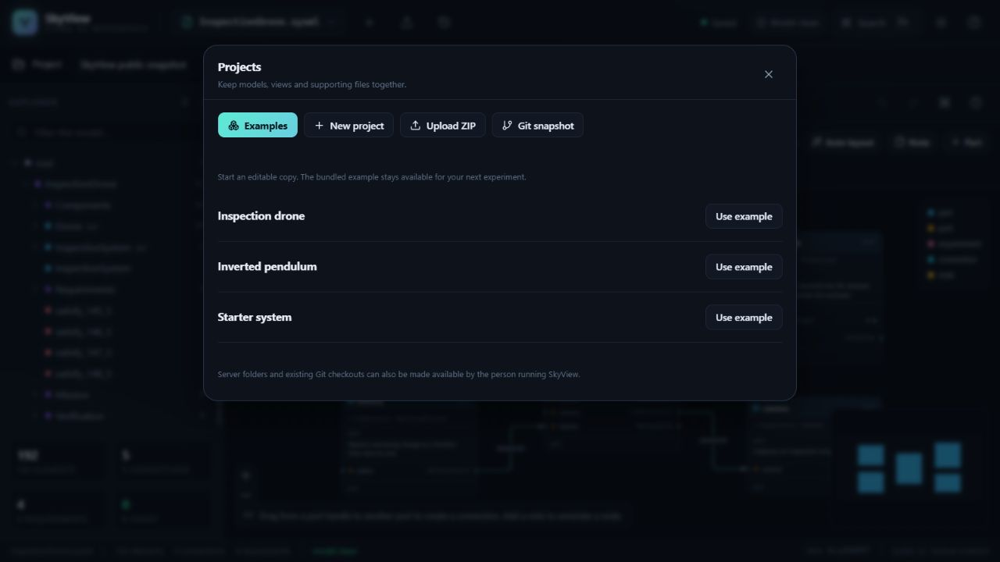

# Projects and portable workspaces

[Back to SkyView](../README.md) · [Run locally](local-development.md) · [API](api.md)

Choose a **Workspace** in the header, then choose a **Project** in the left **Projects** panel.
Use **+** beside either selector to add an item and **…** for its settings and other actions.
The project map lists the selected project's files. Its **Model actions** menu handles model files.

A project is a directory containing models, saved views and supporting files. Diagram, Grid,
Requirements and Source work on the model open in that project.



**Contents:** [Start a project](#start-a-project) · [Local folders](#local-folders) ·
[Directory format](#directory-format) · [Limits](#limits) · [Verification](#verification)

## Start a project

Use **Add project** in the selected workspace. You can add several projects and switch among them
from the project selector. Switching workspaces or projects prompts before discarding unsaved edits.

Open **Project actions → Project settings** to rename a managed project or choose its workspace.
It stays open with the same model paths, history and direct links. **Export project** downloads a ZIP.
**Remove project** removes the entry from the catalog and retains its saved directory on the server.
Save or discard drafts before removing the current project. The operator manages server folders and
legacy workspace files.

Open **Workspace actions → Workspace settings** to rename a workspace. Move or remove its projects
before removing a named workspace. The default workspace remains available for server folders and
legacy files.

| Option | What happens |
| --- | --- |
| Examples | Copies the bundled drone, inverted pendulum or starter system into an independent, editable project. Available in Go, Docker and Podman builds without uploading anything. |
| New project | Creates a project containing `System.sysml`. |
| Upload ZIP | Imports a directory from a ZIP on your computer. Nested paths, binary assets, model text and view files are retained. |
| Git snapshot | Imports a public GitHub.com or GitLab.com repository at a branch, tag or commit, optionally selecting a subdirectory. |
| Export project | Downloads saved models, view files, layouts, supporting assets and a manifest as a ZIP for review or re-import. Save your source draft before exporting. |

For a Git snapshot, enter the repository URL (for example `https://github.com/owner/repository`),
its branch/tag/commit (`HEAD` means the default branch), and the directory to use (`.` means the root).
SkyView resolves the ref to a full commit ID before downloading [1][2]. The project bar shows the
imported ref, commit and directory; the manifest preserves the complete provenance. A branch moving
later cannot silently change the imported files. Import again to create another independent snapshot.

For both ZIP and Git imports, one common enclosing archive folder is removed before selecting the
requested directory. For example, `repo-main/models/cart/Plant.sysml` with directory `models/cart`
becomes `Plant.sysml` at the new project root. Exported SkyView ZIPs include a root manifest, so their
relative directory structure is retained without removing a meaningful model folder.

Each import creates a new project ID. It never replaces an existing project. Switching projects asks
before discarding an unsaved source draft and clears the previous model's undo and validation state.

Private and self-hosted repositories currently use ZIP upload or an explicitly configured local checkout.
SkyView does not ask for Git credentials, execute repository scripts, fetch submodules, commit, push or
pull updates. **Personal accounts and account-bound Git writes belong to a later distributed version.**
There is no shared server Git identity to accidentally attribute your changes to someone else.

## Local folders

A local folder is on the **server running SkyView**, not necessarily the computer running your browser.
The operator exposes chosen directories at startup. From the SkyView repository root:

```sh
go run ./cmd/skyview -addr 127.0.0.1:8081 -project cart=./examples/inverted-pendulum
```

Choose `cart` in the **Default workspace** project selector. Repeat `-project NAME=PATH` for more folders. Names use letters,
digits, dashes or underscores. This opens the actual directory: saves change its files directly,
including files in an existing Git checkout. Use **Examples** when you want an independent copy.
The browser cannot request an arbitrary server filesystem path.

For Docker or Podman, mount the chosen directory and pass its **container** path. Example in a shell
that supports `$(pwd)` (Linux/macOS/WSL), with an existing `my-project` directory at the repository root:

```sh
docker run --rm -p 127.0.0.1:8081:8080 -v skyview-workspace:/data --mount "type=bind,src=$(pwd)/my-project,dst=/projects/cart" skyview:local -project cart=/projects/cart
```

The mounted directory must be writable by the container's UID/GID 65532. On SELinux hosts use a
suitably labelled bind mount, for example Podman's `-v ./my-project:/projects/cart:Z` for a dedicated
project directory. The ordinary named-volume command in the [run guide](local-development.md) needs
no extra mounts for uploads, snapshots or examples.

## Directory format

Managed projects live under `<workspace>/projects/<id>/`. Example contents:

```text
skyview.project.json
models/Plant.sysml
models/Plant.views.json
assets/reference.png
README.md
.skyview/layouts/models/Plant.layout.json
.skyview/history/<source-path-hash>/...
```

`skyview.project.json` version 1 stores a display name and origin (`new`, `example`, `upload` or `git`).
Workspace names and IDs are stored in `.skyview/workspaces.json` at the server data root. Managed
projects record their `workspaceId` in the on-disk manifest. A missing ID means **Default workspace**.
ZIP exports omit the server workspace ID, and imports use the selected destination workspace.
Removing a managed project marks its manifest with `removed: true`. To restore it, stop SkyView,
remove that flag, and set `workspaceId` to an existing workspace or omit it for the default.

A managed ID is its directory name. Display names may repeat. Imported origin metadata is descriptive
and grants no access to a path, repository or account. A configured local folder needs no manifest.

Native `.sysml` files own model meaning. [Shared-view sidecars](model-exchange.md) own selections and
layout. Interactive diagram layouts remain under `.skyview/layouts/`. ZIP exports include layouts and
supporting files but omit Git metadata and SkyView's private revision history. They are reviewable
snapshots, not complete backups. Back up the whole workspace and any separately configured folders
while SkyView is stopped to retain history too.

Existing files at the server data root remain accessible as **Workspace files** within **Default workspace**,
using their original paths and history. Server-configured folders also start in **Default workspace**. The old `/api/files` routes and CLI behavior remain supported. Those legacy routes
list only root-level models; new projects support nested paths. Existing workspace data is not moved.
The versioned example sources now live under [`examples/`](../examples/) and are embedded in builds.

## Limits

- ZIPs: 64 MiB compressed and selected expanded content, 16 MiB per file, 4,000 archive entries.
  At least one visible `.sysml` model is required; its text must be UTF-8. Binary supporting files are allowed.
- Imports reject traversal, absolute paths, symlinks, special files, reserved Windows names and
  duplicate/case-colliding paths. A failed import publishes no partial project. Imported files are data;
  SkyView does not run them. Local folders are trusted operator inputs; concurrent external filesystem
  changes are not a supported synchronization mechanism.
- Nested model files are browsable independently. Cross-file SysML import resolution and unified
  project-wide semantic editing are not implemented. Keep interdependent definitions in a combined
  source bundle when the current parser needs them together.
- Local mode uses a single user's catalog. Hosted mode restricts each catalog to the signed-in account.
  Projects within an account share that account's permissions.
- The editor modifies model sources. ZIP exports preserve supporting files.

## Verification

The native [project contract](../architecture/models/ProjectWorkspaces.sysml) defines PW-01–PW-05.
Its complete source passed the published SysML v2 pilot 2026-04 checker with standard libraries on
2026-11-28, with no reported model errors or warnings. The implementation map is in the
[architecture guide](../architecture/README.md).

| Contract | Executable evidence |
| --- | --- |
| PW-01: preserve paths, source, assets and views | `TestPortableProjectRoundTrip`, `TestProjectLifecycle`, `TestProjectCLIExchange` |
| PW-02: confined access, sibling isolation | `TestArchiveBoundaries`, `TestResolveRejectsSymlinks`, `TestLocalFolderAndStateConfinement`, `TestNestedHistoryIsolation`, `TestProjectLifecycle` |
| PW-03: complete publication only | `TestRejectedImportsPublishNothing`, rejected upload and restart checks in `TestProjectLifecycle` |
| PW-04: pinned snapshot without remote writes | `TestRepositorySnapshot`: both provider adapters, slash-containing refs, commit-pinned retrieval, host/redirect restrictions |
| PW-05: workspace selection and project identity | `TestWorkspaceCatalogPreservesProjectIdentityAndPortability`, `TestCatalogSettingsAndRemoval`, and `web/tests/projects.test.mjs` |
| Example independence and browser lifecycle | `TestBundledExamplesAreIndependent`, `web/tests/projects.test.mjs`, source-editor remount regression |

The built-in browser was used to open the bundled pendulum (194 elements, zero diagnostics, seven
feedback blocks), export and upload its ZIP as another project, and import the public SkyView GitHub
`main` branch's `workspace` directory at commit `b7ab4021222b0a170fc70108fea6fe99843a556d`.
The imported drone loaded with zero diagnostics and five subsystem nodes. Final-build browser checks
also exercised unsaved-draft switch cancellation, inline lint hover/jump/correction without saving,
revert, and the saved-project download button. The Docker image was built
with Go 1.24 and checked for all three bundled examples, a configured bind-mounted folder, ZIP export
and project survival after container removal/recreation with the same named volume. Disposable test
containers and their volume were removed. Podman was not installed for a separate runtime check. GitLab protocol behavior
is covered by controlled HTTP tests; a live GitLab import has not been checked. These checks establish
project storage and supported UI behavior. For hosted account checks, see the [deployment design](../architecture/README.md#deployment).

## References

1. GitHub, [repository ZIP archives](https://docs.github.com/en/rest/repos/contents#download-a-repository-archive-zip).
2. GitLab, [repository archives](https://docs.gitlab.com/api/repositories/#get-file-archive) and
   [commit lookup](https://docs.gitlab.com/api/commits/#get-a-single-commit).
