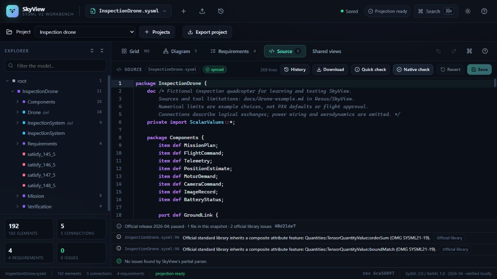

# SysML authority and local code checks

[Back to SkyView](../README.md) · [Viewer direction](viewer-design.md) · [Local development](local-development.md)

SkyView uses the official SysML implementation and matching standard libraries for native code checks.
Published OMG specifications govern language meaning. The Go parser remains a partial projection for
rendering and supported edits; its quick diagnostics are separate from native validation.

## Contents

- [Authority and baseline](#authority-and-baseline)
- [Build channels](#build-channels)
- [Run locally](#run-locally)
- [Editor and API](#editor-and-api)
- [Repository gate](#repository-gate)
- [Coverage and remaining gaps](#coverage-and-remaining-gaps)
- [Design and verification](#design-and-verification)
- [Dependency and license](#dependency-and-license)
- [References](#references)

## Authority and baseline

The [release lock](../internal/standards/release.json) is the source-controlled identity of the build's
standard. It records the specification versions and published/preview status, official release and
pilot commits, publisher-provided kernel archive SHA-256, exact kernel JAR hash, release archive hash,
complete library-tree hash and hashes of every official example. The runtime embeds this lock.
The official release repository supplies libraries/examples; the pilot repository supplies the checker. [1–5]

The current published selection is **SysML 2.0 / KerML 1.0**, official release **2026-04**, with pilot
kernel **0.59.0**. It is the newest release whose notes explicitly identify the published baseline;
newer upstream releases currently contain preliminary 2.1/1.1 material. A published baseline identifies
the intended language version, not proof that the implementation enforces every normative rule. [4–5]

The runtime verifies the installed manifest, JAR and complete library tree against its embedded lock.
A mismatch is unavailable, never a passing check. Results identify the exact model snapshot, lock and
SkyView adapter hashes. The footer reads `/api/standards` from the running backend and shows the actual
release. The checker tooltip gives its integrity state, release commit and hashes. A warning icon marks
an unavailable checker, and preview releases carry a preview label.
Source edits invalidate model-check results independently of toolchain integrity.

Native project files own model meaning; view JSON owns presentation. [Tom Sawyer](viewer-design.md)
guides interaction and appearance, while OMG governs meaning. Grammar files alone do not implement
metamodel validation. Disagreements with the specification remain defects or documented gaps.

## Build channels

From the repository root, with Go 1.24+, Node.js and JDK 21+ installed and `npm --prefix web ci` completed:

```sh
bash deployment/go/build.sh
bin/local/skyview -addr 127.0.0.1:8081
```

The build resolves the release, updates the small lock when necessary, builds the application and
installs matching tools into `bin/local/sysml-<release>`. Keep that directory beside the executable.
All downloaded upstream libraries, examples and binaries stay in ignored `bin/` or the user cache.
They are not added to Git or uploaded to GitHub. Source builds never commit or push changes.

| Build setting | Selection |
| --- | --- |
| `SYSML_CHANNEL=published` (default) | Newest upstream release explicitly tied to published OMG specification documents |
| `SYSML_CHANNEL=latest` | Newest identifiable official release, including preliminary standards; footer marks previews |
| `SYSML_CHANNEL=locked` | Recorded release; no release discovery or lock change |

```sh
SYSML_CHANNEL=latest bash deployment/go/build.sh
SYSML_CHANNEL=locked bash deployment/go/build.sh
```

`make build SYSML_CHANNEL=latest` uses the same workflow inside the Nix environment, which includes JDK21.
The pure `nix build` package embeds the recorded lock and leaves native-tool setup separate, like raw `go build`.
On Windows, use the [AlmaLinux WSL path](local-development.md#windows-with-almalinux-wsl), retaining
Smart App Control. A raw `go build` embeds the current lock without checking the internet or installing
the native dependencies; use the build script for a complete local bundle.

`go run ./cmd/skyview standards-update -channel published` only updates the lock and cached downloads;
rebuild afterward to embed it. Update failures stop the build rather than silently choosing a fallback.
Use `locked` when intentionally offline. First setup still needs either network access or the verified
cached archives; native checks themselves are offline after installation.

Docker/Podman use the same channels:

```sh
SYSML_CHANNEL=published SYSML_REFRESH=2026-11-27 bash deployment/docker/build.sh -t skyview:local
docker run --rm -p 127.0.0.1:8081:8080 -v skyview-workspace:/data skyview:local
```

`make docker SYSML_CHANNEL=latest` supplies a fresh timestamp automatically; its default channel is published.
For direct Docker/Podman commands, change `SYSML_REFRESH` or disable build caching for a fresh lookup. Docker otherwise
may reuse a previously resolved layer. Use `SYSML_CHANNEL=latest` for the explicit preview option or
`locked` for repeatable release builds. The image contains `/app/standards-release.json` and matching
local tools. Docker's generated lock stays in the image; refresh the source lock before building when
the selected update should also be reviewable in Git. CI validates the checked-in lock without updating it.

`--target minimal` builds the Go-only runtime without a checker or JDK. It still shows the compiled
language version, with native checking unavailable. The default image includes both.

## Run locally

For `go run` or an ordinary executable build, install the pinned checker once:

```sh
go run ./cmd/skyview standards-setup
go run ./cmd/skyview standards-info
go run ./cmd/skyview lint -project-dir examples/inspection-drone -report bin/drone-native.json
```

Setup downloads approximately 220 MB for the current release, verifies its hashes, and installs into
the platform user cache (`~/.cache/skyview/sysml/2026-04` on Linux/WSL). It executes no upstream install
scripts. A JDK is required because the adapter uses Java source launching. In AlmaLinux WSL install
`java-21-openjdk-devel`. Existing installations for other releases are retained.

`SKYVIEW_SYSML_HOME` overrides the installation directory; `SKYVIEW_SYSML_JAVA` overrides the server's
Java executable. CLI options include `-toolchain`, `-java` and setup's `-cache`. `standards-info` reports
the compiled/installed identity and returns failure for unavailable or mismatched tools. Fix or install
the selected release explicitly; an existing directory failing integrity checks is never overwritten.

## Editor and API

**Quick check** reports partial Go rendering diagnostics. **Native check** validates every `.sysml` and
`.kerml` source in the selected project with the current unsaved draft overlaid, without saving it.
The official parser indexes the complete project before resolution and runs `CheckMode.ALL`. SkyView's
documented supplementary rules operate on that resolved native model, not regular expressions.

`POST /api/projects/{project}/files/{name}/validate-native` accepts optional `{"content":"draft"}`.
The legacy `/api/files/{name}/validate-native` checks root-level workspace models only. Valid requests
return `status: passed | failed | unavailable`, release and identity metadata, source hash, file count,
and per-file diagnostics. `libraryDiagnostics` separately records inherited defects in the official
library; `passed` means the project checks found no errors. `lint -strict-library` also fails on these
dependency findings. The editor displays them alongside the project outcome. Consumers must inspect status. Invalid inputs return HTTP 400. Missing tools,
busy checks, timeout, process failure and incomplete output never become empty successful results.

`GET /api/standards` returns the live build/installation identity with `Cache-Control: no-store`.
`verified` refers to dependency identity; a model is checked only by an explicit validation request.

Messages underline UTF-8 source ranges mapped into the editor's UTF-16 positions. Other-file messages
retain their project-relative path. Editing, reverting or changing documents invalidates old results.
The checker uses a separate Java process per request, one concurrent process per application, a 120-second
deadline and 1 GB Java heap. Projects are bounded to 1,000 files, 32 MB total and 16 MB per file. No model
simulation runs. Large projects can exceed these bounds and report unavailable. The CLI accepts
`-timeout` for larger batch checks; the repository/CI gate uses five minutes per project because the
official Annex A vehicle example can exceed the interactive deadline. Timeouts remain failed attempts.



## Repository gate

```sh
go run ./cmd/skyview lint -repository -timeout 5m -report bin/sysml-validation/latest.json
```

This is the shared local/GitHub/GitLab entry point. It checks all first-party models, every checksum-pinned
upstream example grouped into its intended project, cross-file/library controls and invalid-model controls.
Independent revisions and the Annex A vehicle model are separate inputs. Three composite-item errors
in the unchanged 2026-04 geometry examples are explicit negative controls, matched by file, constraint and
line against that exact release commit. Their native result remains `failed`; a missing, different or extra
finding fails the regression gate. This does not exempt any user project. Upstream failures remain visible;
upstream fixtures are not edited to satisfy SkyView. The suite records the current attempt as `running`
before execution and updates it throughout. CI retains failed reports. A missing dependency or empty
project fails the gate. The upstream examples provide broad regression coverage, not an exhaustive
OMG conformance test suite. Go/frontend tests independently verify integration and source preservation.

## Coverage and remaining gaps

The official implementation checks textual syntax, name resolution and its implemented metamodel
constraints for the complete language, including constructs the Go renderer cannot display. It loads
the full matching standard libraries. SkyView supplements the published pilot with seven SysML 2.0
checks. These cover non-composite attribute definitions/usages, incoming succession counts for decisions
and forks, outgoing succession counts for joins and merges, and the explicit target multiplicity of a
succession leaving a decision node. Diagnostics identify the normative constraint name. [1,5]

The pilot still has unfinished checks, including some subsetting/redefinition multiplicity constraints,
binding type/cast constraints and other control-node rules. General inherited/redefined control-node
behavior remains unverified. A passing report records zero project errors from the named checker and
source snapshot. Review warnings alongside the result.
The published libraries themselves contain the defect recorded as
[OMG SYSML21-19](https://issues.omg.org/issues/SYSML21-19), including composite constraints inherited
by quantity values. These remain visible in `libraryDiagnostics`, attributed to the dependency.
Use `lint -strict-library` to make them fail the result as well; no official library is patched or its
hash changed.

### Tool conformance

OMG SysML 2.0 Part 1, Clause 2 requires both abstract syntax and model interchange conformance for
modeling tools. Concrete syntax (textual or graphical) and semantic conformance are further claims. [1]

| Capability | Current SkyView coverage |
| --- | --- |
| Abstract syntax | The pinned validator checks project snapshots. The browser and Go editor expose selected metaclasses and edits. Full metamodel CRUD and constraint coverage remain open. |
| Model interchange | Native text and SkyView project ZIPs are supported. The normative `.kpar` interchange format remains open. |
| Textual notation | The editor preserves SysML source and exposes native diagnostics. The visual projection recognizes a subset. |
| Graphical notation | Shared structural projections have bounded coverage. Native viewpoints, view conditions, and the complete standard view definitions remain open. See the [viewer coverage](viewer-design.md#model-view-coverage). |
| Semantics and service API | General model evaluation, execution, and conformance to the separate OMG Systems Modeling API remain open. |

## Design and verification

[StandardsValidation.sysml](../architecture/models/StandardsValidation.sysml) owns this capability.

| Obligation | Implementation and evidence |
| --- | --- |
| SV-01: exact tools, source and visible version | `toolchain.go`, `identity.go`, manifest/hash tests, footer/API tests |
| SV-02: complete isolated project | Java parse/index/validate phases; native cross-file and isolation controls |
| SV-03: preserve source/drafts | Server snapshot and source-editor tests |
| SV-04: honest outcomes | Missing-tool, timeout, range, draft-staleness and invalid-model controls |
| SV-05: published default and explicit preview | `update.go`, build-channel/offline tests, local build script and Docker args |

The [validation record](sysml-validation.json) records the tested release, source identities and current
outcomes. Hosted CI is distinct from local verification and runs only after a future push.

## Dependency and license

SkyView's original Go code and adapter remain MIT. The official pilot/libraries use EPL-2.0. Setup retains
their license, immutable source links and the unchanged JAR's notices. Its bundled PlantUML 1.2022.7 uses
EPL-1.0 and is not used for SkyView rendering. Keep notices and upstream source availability with distributed
bundles/images; see [third-party notices](../THIRD_PARTY_NOTICES.md). No Tom Sawyer SDK is included. [4–6]

## References

1. OMG, [SysML 2.0 language specification](https://www.omg.org/spec/SysML/2.0/Language/PDF), especially clauses 2, 8.3.7 and 8.3.17.
2. OMG, [KerML 1.0](https://www.omg.org/spec/KerML/1.0).
3. OMG, [Systems Modeling API and Services 1.0](https://www.omg.org/spec/SystemsModelingAPI/1.0).
4. Systems-Modeling, [published-baseline release 2026-04](https://github.com/Systems-Modeling/SysML-v2-Release/releases/tag/2026-04).
5. Systems-Modeling, [pilot 2026-04](https://github.com/Systems-Modeling/SysML-v2-Pilot-Implementation/releases/tag/2026-04) and [native validator source](https://github.com/Systems-Modeling/SysML-v2-Pilot-Implementation/blob/20897e3122f2c2f8b29389745f0caaaeb7c6e21a/org.omg.sysml.xtext/src/org/omg/sysml/xtext/validation/SysMLValidator.xtend).
6. Systems-Modeling, [license at the pinned pilot commit](https://github.com/Systems-Modeling/SysML-v2-Pilot-Implementation/blob/20897e3122f2c2f8b29389745f0caaaeb7c6e21a/LICENSE).
